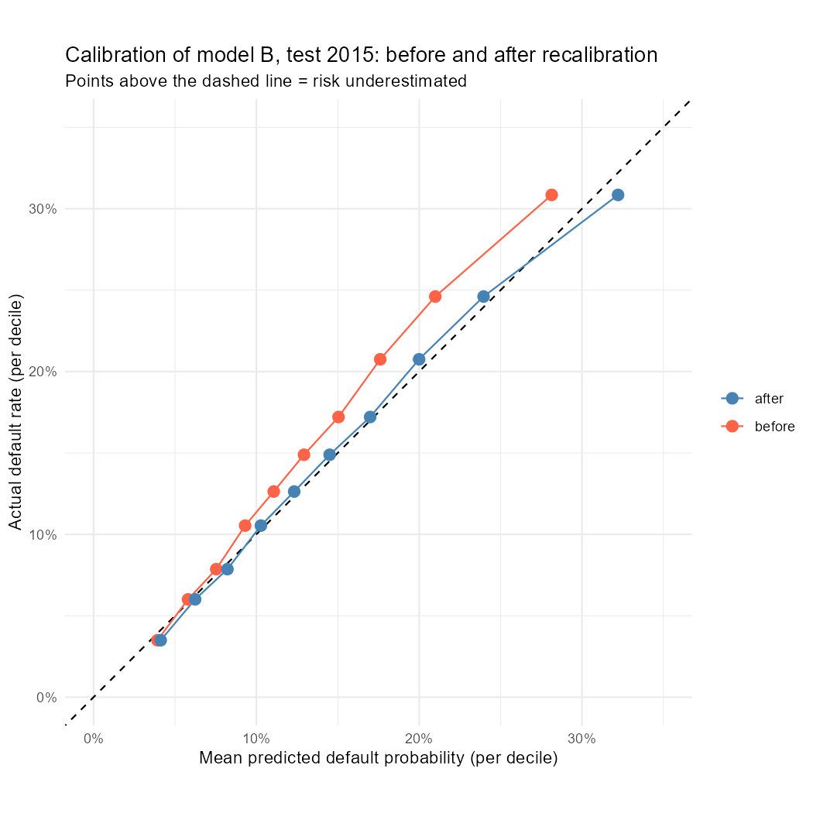
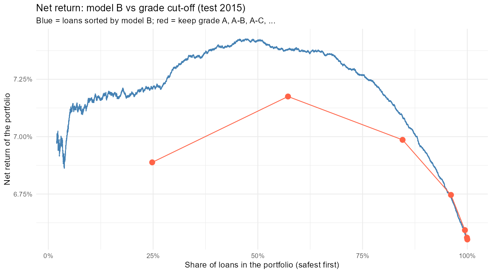

# Credit Risk & Loan Portfolio Analysis (LendingClub)

End-to-end analysis of credit risk and profitability on the public **LendingClub** consumer-loan dataset (2007-2018, Kaggle): SQL for the analysis, R for a default-probability model, Power BI for an interactive dashboard.


## Summary

**What changed.** Between 2013 and 2015 the net return on 36-month loans fell from 11.1% to 6.6% while the default rate rose from 12.3% to 14.9%. By 2015 grades F and G lose money (-1.8% and -5.3%).

**Why.** Not because of a riskier loan mix: grade mix, FICO and loan size are stable. Default rates rose in every grade, while the interest rate charged for the same sub-grade fell in all 25 sub-grades A1-E5 (by 0.4-2.5 pp). Roughly 60% of the fall in return comes from fully paid loans earning less, 30% from more charge-offs and 10% from larger losses per charge-off. Pricing also ignores DTI within a grade: default rates rise by 3-14 pp between low and high DTI, interest rates barely move.

**What it means.** Pricing followed the grade almost exclusively and did not react to rising defaults or to DTI. Selecting loans with a model built on borrower data earns +0.2-0.3 pp more than a grade cut-off, a small but statistically reliable gain. A model trained on 2012-2014 underestimates 2015 risk by 1.2-3.6 pp from decile 4 up, so it would need recalibration on recent data before being used for pricing. The data cannot show why rates fell, and returns are nominal.

**Full context.** [Data and method](#data-and-method), [Results 1-7](#results), [Limitations](#limitations), [Power BI dashboard](#power-bi-dashboard).


The project asks three questions:

1. How well do the platform's risk grades (A-G) separate risky loans from safe ones?
2. Do higher interest rates actually compensate for higher losses?
3. How much of default can be predicted from data known at application time, and does a model trained on older loans still work on newer ones?

**Tools:** SQL Server (SSMS), T-SQL (CTEs, aggregations, window functions); R (logistic regression with `glm`, `pROC`, `dplyr`, `ggplot2`, `DBI`/`odbc`); Power BI (6-page dashboard with a what-if scenario page).

**Requirements to reproduce:** Windows, SQL Server 2017+ (`BULK INSERT` from `C:\data`, Windows authentication), ODBC Driver 17 for SQL Server, R, Power BI Desktop.

## Key findings

All results below refer to the analysis base: **36-month loans issued in 2012-2015** (589,488 loans, overall default rate 14.0%). See "Data and method" for why.

- **Grades separate risk very well.** Default rate rises steadily from 5.5% (grade A) to 40.2% (grade G).
- **Pricing does not keep up with risk.** From A to G the default rate grows ~7.4x, while the interest rate grows only ~3.6x. Over 2012-2015 as a whole all grades are profitable on a nominal basis, but net return peaks in grade B (+9.0%) and falls to +3.9% in G.
- **Defaults are costly in every grade.** Charged-off loans lose 35-41% of the funded amount, while fully paid loans earn more the riskier the grade (+9.7% in A, +33.0% in G).
- **DTI and income carry information of similar strength.** Default rate almost doubles from the lowest to the highest DTI band (10.8% to 20.1%) and falls by ~46% from the lowest to the highest income quartile (18.6% to 10.1%). DTI still predicts default *within* every grade, yet interest rates barely react to it.
- **Purpose matters little**, except small-business loans, the riskiest sizeable category (22.5% default rate vs 11.7% for credit-card refinancing).
- **Time trends:** from 2013 to 2015 the default rate rises (12.3% to 14.9%) and net return falls (11.1% to 6.6%). Vintages from 2016 on are incomplete (right-censored) and should not be interpreted.
- **The fall in return is not a mix effect.** Grade mix, FICO and loan size are stable, while default rates rise within every grade and the average interest rate within grades A-E falls by 0.8-2.5 pp. This is repricing, not sub-grade mix: in all 25 sub-grades A1-E5 the interest rate is lower in 2015 than in 2013 (by 0.4-2.5 pp) while the default rate is higher. By 2015 grades F and G lose money (-1.8% and -5.3%).
- **A default model trained on 2012-2014 ranks 2015 loans reasonably but underestimates their risk.** Logistic regression on borrower data plus grade reaches AUC 0.685 on the 2015 test set (grade alone: 0.668, borrower data without grade: 0.655). Actual default rates rise from 3.5% to 30.8% across risk deciles, but from decile 4 up the model predicts 1.2-3.6 pp too little, consistent with the drift found in SQL.
- **Model-based selection beats a grade cut-off, but only slightly.** At the same portfolio size, picking loans by the model's predicted risk earns +0.2 to +0.3 pp more net return (nominal, whole loan life) than keeping grade A or A-B; the bootstrap interval is above zero (see Results 7.4).
- **Scenario analysis:** a simple what-if on the dashboard shows how net return by grade reacts to more defaults and to lower returns on fully paid loans. Roughly 60% of the 2013-2015 fall in return came from paid loans earning less, so pricing matters at least as much as defaults.
- **Robustness:** the grade ranking of default rates also holds for 60-month loans (2012 vintage), but the shape of net return by grade does not (see Results 1). The return pattern is therefore specific to 36-month loans.

## Data and method

- **Source:** LendingClub accepted-loans file from [Kaggle](https://www.kaggle.com/datasets/wordsforthewise/lending-club) (~150 columns, 2M+ loans).
- **Loans with a final outcome:** 1,345,310 loans with status `Fully Paid` or `Charged Off`. Loans still running (`Current`, `Late`) are excluded because their outcome is unknown.
- **Default definition:** `is_default = 1` for `Charged Off`, `0` for `Fully Paid`.
- **Default rate** = share of defaulted loans.
- **Net return (nominal)** = (total payments received - total funded amount) / total funded amount. `total_pymnt` already includes recoveries (checked in the data).

### Analysis base: complete vintages

Keeping only finished loans creates **right-censoring**: loans issued recently are in the data only if they ended early (early prepayment or early default), so recent vintages look different from what they would be once complete. To avoid this, all main results use the view `loans_complete`: **36-month loans issued 2012-2015**, which had nearly all finished by the end of the data.

- Of 589,635 such loans, 147 (0.025%) were still running or late at the end of the data and are excluded. Even if all of them ended in charge-off, the default rate would rise by only ~0.02 pp.
- Section 5 shows where the data breaks, and Results 1 shows how different the picture is on all loans.

| Object | Description |
|---|---|
| `loans_raw` | Full file loaded with `BULK INSERT`, all columns stored as text. |
| `loans_clean` | 36 selected columns converted to proper types (numbers, dates), filtered to loans with a final outcome, with the `is_default` flag. |
| `loans_complete` | View on `loans_clean`: 36-month loans issued 2012-2015 (589,488 loans). Used for all results except Section 5 and the reference tables. |
| `v_*` views | Small aggregate views that feed the Power BI dashboard (see "Power BI dashboard"). |

The raw file contains free-text fields, mostly empty columns and hardship/settlement details that are irrelevant for a portfolio-level risk analysis, so only five groups of columns were kept:

1. **Identification and outcome:** loan id, status, `is_default`, issue date
2. **Loan terms:** amount, term, interest rate, installment, `grade`, `sub_grade`
3. **Borrower profile:** income, employment length, home ownership, purpose, state
4. **Credit history:** FICO range, `dti`, delinquencies, credit utilisation and other bureau indicators
5. **Repayment and recovery:** total payments, principal, interest, recoveries

> Group 5 is only known after a loan is issued. It is used for loss and profitability analysis only and **is not used as input to the predictive model** (data leakage).

### Model setup (R)

- **Input:** `loans_complete` exported to R through ODBC (`r/01_load_data.R`).
- **Target:** `is_default`. **Predictors:** only variables known at application time (log income, DTI, FICO, loan amount, employment length, home ownership, purpose, income verification, revolving utilisation, recent inquiries, delinquencies, public records).
- **Model rows:** 589,186 loans (302 dropped: missing DTI or revolving utilisation, or zero income).
- **Time split, not random:** trained on 2012-2014 (306,288 loans, default rate 13.25%), tested on 2015 (282,898 loans, 14.88%). This mimics real use and tests robustness to the drift seen in the SQL analysis.
- **Metrics:** AUC (ranking quality) and a decile calibration check (do predicted probabilities match actual default rates).

## Results

### 1. Risk and return by grade

Analysis base: 36-month loans issued 2012-2015 (589,488 loans). Overall default rate 14.03%, nominal net return +8.24%.

| Grade | Loans | Default rate | Avg. interest rate | Net return |
|---|---|---|---|---|
| A | 133,261 | 5.45% | 7.21% | +7.29% |
| B | 202,303 | 11.22% | 10.86% | +8.99% |
| C | 156,060 | 18.03% | 13.94% | +8.64% |
| D | 72,814 | 23.57% | 17.26% | +7.98% |
| E | 20,535 | 28.92% | 19.98% | +6.22% |
| F | 4,052 | 33.14% | 23.90% | +5.96% |
| G | 463 | 40.17% | 26.27% | +3.91% |

**Net return by outcome:**

| Grade | Fully paid | Charged off |
|---|---|---|
| A | +9.66% | -35.76% |
| B | +14.45% | -35.11% |
| C | +18.39% | -35.91% |
| D | +22.55% | -37.27% |
| E | +25.66% | -38.55% |
| F | +31.26% | -39.37% |
| G | +32.99% | -40.80% |

- Default rate grows ~7.4x from A to G (5.5% to 40.2%), while the interest rate grows only ~3.6x (7.2% to 26.3%). Higher risk is not fully compensated by pricing.
- Over 2012-2015 as a whole all grades are profitable on a nominal basis, but net return peaks in grade B (+8.99%) and falls to +3.91% in G (463 loans, less reliable). Within single vintages the picture is worse for low grades (see Section 6).
- Charged-off loans lose 35-41% of the funded amount (borrowers repay roughly 60-65% before default, recoveries included). The loss rises mildly with risk. Fully paid loans earn more as risk grows (+9.7% in A, +33.0% in G), so differences in return between grades come mainly from how often defaults occur.

**Why complete vintages?** The same query on all loans (all vintages, both terms) gives a very different picture:

| Grade | Loans | Default rate | Net return |
|---|---|---|---|
| A | 235,090 | 6.04% | +5.40% |
| B | 392,741 | 13.39% | +5.26% |
| C | 381,686 | 22.44% | +2.77% |
| D | 200,953 | 30.38% | +0.53% |
| E | 93,650 | 38.48% | -1.26% |
| F | 32,058 | 45.20% | -3.90% |
| G | 9,132 | 49.93% | -8.70% |

Recent vintages are right-censored (see Section 5), and the sample also mixes 36- and 60-month loans. Together this makes high grades look loss-making, which is not the case on complete vintages. The two effects are not separated here, so the difference should not be attributed to censoring alone.

**Robustness check: 60-month loans, 2012 vintage.** These loans matured in 2017, before the end of the data, so the vintage is complete.

| Grade | Loans | Default rate | Avg. interest rate | Net return |
|---|---|---|---|---|
| A | 148 | 7.43% | 8.44% | +13.08% |
| B | 1,702 | 16.92% | 12.31% | +15.48% |
| C | 1,973 | 22.55% | 15.42% | +17.31% |
| D | 2,235 | 28.77% | 18.80% | +16.98% |
| E | 2,390 | 33.64% | 21.13% | +19.10% |
| F | 1,212 | 36.80% | 23.11% | +20.11% |
| G | 237 | 43.88% | 24.48% | +18.25% |

- The ranking of default rates by grade is the same (7.4% to 43.9%, ~5.9x), and it again grows faster than the interest rate (~2.9x).
- Net return does **not** fall with risk here: it rises from +13.1% in A to +20.1% in F. The "peak in B, then decline" pattern found for 36-month loans is therefore not robust across loan terms. Returns are nominal over the whole loan life, so 60-month figures (about 5 years) are not comparable with 36-month figures (3 years). Grades A and G have only 148 and 237 loans.

### 2. Risk by purpose

| Purpose | Loans | Default rate | Avg. interest rate |
|---|---|---|---|
| small_business | 6,165 | 22.51% | 15.80% |
| moving | 4,139 | 19.50% | 15.70% |
| medical | 6,382 | 17.25% | 14.14% |
| other | 30,570 | 16.40% | 14.53% |
| vacation | 3,991 | 15.89% | 14.36% |
| debt_consolidation | 337,680 | 14.70% | 12.24% |
| major_purchase | 11,200 | 13.09% | 11.86% |
| home_improvement | 33,568 | 12.53% | 11.78% |
| car | 5,914 | 11.94% | 11.58% |
| credit_card | 145,994 | 11.71% | 10.72% |

Categories with fewer than ~3,000 loans are too small for reliable conclusions and are left out of the table: renewable_energy (394 loans, 20.3%), house (2,316, 18.3%), wedding (1,174, 12.7%), educational (1 loan).

- Debt consolidation and credit-card refinancing make up ~82% of the portfolio.
- Among categories with enough loans, default rates range from 11.7% to 22.5%, much narrower than the range across grades (5.5% to 40.2%).
- Small-business loans are the riskiest sizeable category, with a default rate almost twice that of credit-card refinancing (22.5% vs 11.7%). Their average interest rate is higher too (15.8% vs 10.7%), but this is likely driven mostly by grade, since riskier purposes tend to get lower grades. This was not checked within grade.

### 3. Risk by debt-to-income ratio (DTI) and income

| DTI band | Loans | Default rate | Avg. interest rate |
|---|---|---|---|
| 0-10 | 111,810 | 10.83% | 11.56% |
| 10-20 | 251,780 | 12.65% | 11.77% |
| 20-30 | 177,138 | 16.35% | 12.36% |
| 30-40 | 48,724 | 20.11% | 13.59% |

The 40+ band (34 loans, 23.5% default rate) and 2 loans with missing DTI are left out of the table. In 2012-2015 LendingClub almost never lent above DTI 40.

| Income quartile | Annual income | Loans | Default rate | Avg. interest rate |
|---|---|---|---|---|
| 1 (lowest) | up to $43,000 | 147,372 | 18.55% | 13.35% |
| 2 | $43,000-60,000 | 147,372 | 14.78% | 12.28% |
| 3 | $60,000-87,600 | 147,372 | 12.70% | 11.66% |
| 4 (highest) | above $87,600 | 147,372 | 10.10% | 10.95% |

- Default rate almost doubles from the lowest to the highest DTI band (10.8% to 20.1%, ~1.9x), while the interest rate rises by only ~18% (+2.0 pp).
- Default rate falls by ~46% (relative) from the lowest to the highest income quartile (18.6% to 10.1%), while the interest rate falls by only ~18% (-2.4 pp).
- DTI and income are of similar strength as risk signals here (spread of 9.3 pp across DTI bands, 8.5 pp across income quartiles). They are correlated with each other, so the two effects overlap.

### 4. Does DTI matter within a grade?

Default rate (%) by grade and DTI band:

| Grade | 0-10 | 10-20 | 20-30 | 30-40 |
|---|---|---|---|---|
| A | 4.27 | 5.15 | 6.81 | 7.65 |
| B | 9.40 | 10.65 | 12.80 | 13.18 |
| C | 15.00 | 16.72 | 20.05 | 21.35 |
| D | 19.51 | 22.28 | 25.74 | 26.66 |
| E | 23.08 | 27.02 | 31.45 | 34.16 |
| F | 26.58 | 31.51 | 35.52 | 40.93 |
| G | 30.77 | 34.56 | 48.95 | 42.45 |

The 40+ band (34 loans in total) is left out. Grade G bands have only 78-143 loans each, so its irregularity (48.95% in 20-30 vs 42.45% in 30-40) is within statistical noise.

**Interest rate vs. default rate within a grade (DTI 0-10 vs. 30-40):**

| Grade | Avg. interest rate, DTI 0-10 | Avg. interest rate, DTI 30-40 | Interest rate change | Default rate change |
|---|---|---|---|---|
| A | 7.13% | 7.46% | +0.33 pp | +3.38 pp |
| B | 10.81% | 10.78% | -0.03 pp | +3.78 pp |
| C | 13.98% | 13.80% | -0.19 pp | +6.35 pp |
| D | 17.38% | 16.97% | -0.41 pp | +7.15 pp |
| E | 20.14% | 19.61% | -0.53 pp | +11.08 pp |
| F | 23.95% | 23.77% | -0.18 pp | +14.35 pp |
| G | 26.36% | 26.20% | -0.16 pp | +11.68 pp |

- Within every grade, default rate rises with DTI. For grades A-B the DTI effect (+3.4 to +3.8 pp between DTI 0-10 and 30-40) is smaller than the gap between neighbouring grades (~5.8-6.8 pp), for C it is similar, and for D-G it is larger (+7 to +14 pp). Grade therefore does not capture all DTI-related risk, especially for lower grades.
- **DTI is not priced within a grade:** between DTI 0-10 and 30-40 the average interest rate changes by only -0.5 to +0.3 pp (and is slightly lower for high DTI in grades C-G), while default rates rise by 3-14 pp. One step down in grade adds ~3 pp of interest (2.4-3.9 pp), so pricing responds almost only to the grade.
- This is an association, not a causal effect: grade is itself partly derived from DTI.

### 5. Trends by issue year

36-month loans, by issue year:

| Issue year | Loans | Default rate | Net return | Status |
|---|---|---|---|---|
| 2012 | 43,470 | 13.58% | +10.19% | complete |
| 2013 | 100,422 | 12.33% | +11.05% | complete |
| 2014 | 162,570 | 13.73% | +9.00% | complete |
| 2015 | 283,026 | 14.89% | +6.55% | complete |
| 2016 | 232,353 | 19.85% | +1.02% | censored |
| 2017 | 128,538 | 20.01% | -5.89% | censored |
| 2018 | 41,268 | 13.24% | -8.32% | censored |

**Reliable part: 2012-2015.** Since 2013 the default rate rose from 12.3% to 14.9% and the net return fell from 11.1% to 6.6%, while issuance grew from ~100k to ~283k loans. The 2012 vintage does not follow the pattern (13.6% default rate, +10.2% return), but it is small (43k loans). Section 6 looks at what drives the fall in return.

**Right-censored part: 2016-2018.** The data contain only loans with a final outcome, so recent vintages miss their still-running loans. Evidence (average months from issue to the last recorded payment):

| Issue year | Fully paid: months to last payment | Charged off: months to last payment | Charged off: net return |
|---|---|---|---|
| 2012 | 27.3 | 16.9 | -37.88% |
| 2013 | 26.0 | 17.3 | -34.29% |
| 2014 | 25.3 | 17.4 | -34.43% |
| 2015 | 25.6 | 17.0 | -37.47% |
| 2016 | 19.9 | 14.6 | -45.75% |
| 2017 | 11.1 | 9.9 | -61.53% |
| 2018 | 5.4 | 4.7 | -83.14% |

From 2016 on, fully paid loans are mostly early prepayments (little interest earned) and charged-off loans are early defaults (little repaid). The negative returns and the 2018 drop in default rate are artefacts of the data cut-off, not changes in portfolio quality.

**Where exactly does the data break?** Quarter by quarter:

| Quarter | Loans | Default rate | Months to last payment | Net return |
|---|---|---|---|---|
| 2015 Q1 | 56,568 | 14.83% | 24.2 | +7.17% |
| 2015 Q2 | 64,222 | 15.38% | 24.3 | +6.49% |
| 2015 Q3 | 73,567 | 14.58% | 24.4 | +6.79% |
| 2015 Q4 | 88,669 | 14.82% | 24.3 | +5.99% |
| 2016 Q1 | 89,784 | 16.10% | 23.2 | +4.76% |
| 2016 Q2 | 50,301 | 22.37% | 17.9 | -0.64% |

Average time to last payment is flat through 2015 Q4 and starts falling in 2016 Q1, so all of 2015 is treated as complete.

### 6. Why does return fall in 2013-2015?

**Portfolio level** (36-month loans):

| Issue year | Loans | Avg. interest rate | Grades A-B | Grades D-G | Avg. FICO (low) | Avg. loan amount | Net return |
|---|---|---|---|---|---|---|---|
| 2012 | 43,470 | 12.63% | 63.4% | 13.8% | 701 | $11,682 | +10.19% |
| 2013 | 100,422 | 13.37% | 57.1% | 18.3% | 695 | $12,667 | +11.05% |
| 2014 | 162,570 | 12.47% | 54.6% | 18.3% | 693 | $12,586 | +9.00% |
| 2015 | 283,026 | 11.28% | 57.2% | 15.5% | 694 | $12,806 | +6.55% |

Grade mix does not explain the decline: in 2015 the portfolio is not riskier than in 2013 by mix (grades D-G fell from 18.3% to 15.5%), and FICO and loan size are almost unchanged. The average interest rate, however, fell by 2.1 pp.

**By grade, 2013 vs 2015:**

| Grade | Default rate 2013 | Default rate 2015 | Change | Avg. interest rate 2013 | Avg. interest rate 2015 | Change | Net return 2013 | Net return 2015 | Change |
|---|---|---|---|---|---|---|---|---|---|
| A | 4.56% | 5.42% | +0.86 pp | 7.70% | 6.90% | -0.80 pp | +8.44% | +6.89% | -1.55 pp |
| B | 9.79% | 11.90% | +2.11 pp | 11.80% | 10.02% | -1.78 pp | +11.11% | +7.43% | -3.68 pp |
| C | 15.30% | 19.44% | +4.14 pp | 15.39% | 13.24% | -2.15 pp | +12.49% | +6.54% | -5.95 pp |
| D | 20.39% | 26.22% | +5.83 pp | 18.66% | 16.64% | -2.02 pp | +12.18% | +4.91% | -7.27 pp |
| E | 23.31% | 32.84% | +9.53 pp | 21.57% | 19.11% | -2.46 pp | +12.35% | +2.16% | -10.19 pp |
| F | 26.81% | 42.40% | +15.59 pp | 23.92% | 23.54% | -0.38 pp | +11.10% | -1.81% | -12.91 pp |
| G | 26.67% | 46.12% | +19.45 pp | 25.75% | 26.87% | +1.12 pp | +1.38% | -5.33% | -6.71 pp |

Grade G has only 15 loans in 2013 (245 in 2015), so its row is noise.

**By outcome:**

| Issue year | Fully paid: net return | Charged off: net return | Default rate |
|---|---|---|---|
| 2012 | +17.66% | -37.88% | 13.58% |
| 2013 | +17.12% | -34.29% | 12.33% |
| 2014 | +15.62% | -34.43% | 13.73% |
| 2015 | +14.00% | -37.47% | 14.89% |

- Default rates rise from 2013 to 2015 in every grade, and the lower the grade, the stronger the rise (+0.9 pp in A, +15.6 pp in F). Net return falls in every grade, again more strongly in lower grades.
- Within grades A-E the average interest rate fell by 0.8-2.5 pp over the same time. Holding the 2015 grade mix fixed, this accounts for roughly 1.7 pp of the 2.1 pp fall in the average rate, the rest comes from the change in mix. Grade F was flat and G rose (small samples).
- A rough breakdown of the 4.5 pp fall in net return (weighted by loan counts): about 60% comes from fully paid loans earning less (+17.1% to +14.0%), about 30% from more charge-offs (12.3% to 14.9%) and about 10% from larger losses per charge-off (-34.3% to -37.5%).

**Is it repricing or sub-grade mix?** The average rate inside a grade also depends on how many loans fall into cheap (A1) versus expensive (A5) sub-grades. Splitting the 2013 to 2015 change in each grade's average rate:

| Grade | Change in avg. interest rate | of which: same sub-grade, different rate | of which: sub-grade mix |
|---|---|---|---|
| A | -0.80 pp | -0.74 pp | -0.06 pp |
| B | -1.78 pp | -1.88 pp | +0.10 pp |
| C | -2.14 pp | -2.16 pp | +0.01 pp |
| D | -2.03 pp | -1.98 pp | -0.05 pp |
| E | -2.46 pp | -2.35 pp | -0.11 pp |
| F | -0.38 pp | -0.46 pp | +0.08 pp |

Grade G is left out (sub-grades G4-G5 have no loans in 2013). Totals differ from the table above by up to 0.01 pp because of rounding.

- Almost all of the change is repricing of the same sub-grades. In every one of the 25 sub-grades from A1 to E5 the average interest rate is lower in 2015 than in 2013 (by 0.4 to 2.5 pp) and the default rate is higher. In F and G the picture is mixed (rates fell by 0.1-1.1 pp in F1-F3 and rose by 0.1-1.2 pp in F4-G3) and samples are small (18-514 loans per sub-grade and year in F, 0-95 in G).
- So over 2013-2015 realised default rates rose in every grade while the interest rate charged for the same sub-grade fell. Lower rates are consistent with fully paid loans earning less, and rising defaults with the larger fall in return in low grades. The data cannot show why rates fell or whether the rise in defaults could have been foreseen at issue.

### 7. Default model (R)

Logistic regression of `is_default` on variables known at application time (see "Model setup"). Trained on 2012-2014, tested on 2015.

**7.1 Is employment length a useful predictor?**

| Variable | Cramér's V | V² (share of variance, single variable) |
|---|---|---|
| grade (benchmark) | 0.194 | 3.8% |
| emp_length | 0.052 | 0.27% |

- `emp_length` is ~14x weaker than grade. Only two categories stand out: *unknown* (6.0% of loans, 20.5% default rate) and *10+ years* (12.6%); the other categories are within 13.8-14.7%.
- Added to income, DTI, FICO and loan amount, `emp_length` is statistically significant (likelihood-ratio test: deviance drop 177.66 on 11 df, p < 2.2e-16) but reduces deviance by only 0.08%: a real but very weak signal. With 589k loans even small effects are significant, so effect size matters more than the p-value.
- Odds ratios vs "< 1 year": 10+ years 0.885, unknown 1.198. The *unknown* group has a 5-8 pp higher raw default rate in every training year, so it is a stable signal rather than an artefact of one vintage.
- The 12 categories were merged into 3 (`<10 years`, `10+ years`, `unknown`): lowest AIC (231,665 vs 231,672 for the full variable), and the likelihood-ratio test finds no evidence that the full variable is better (p = 0.245).

**7.2 Model comparison (test set = 2015 loans, never seen by the model)**

| Model | AUC | Gini |
|---|---|---|
| Grade only | 0.6675 | 0.34 |
| Borrower data only (no grade) | 0.6549 | 0.31 |
| Borrower data + grade | 0.6851 | 0.37 |
| Borrower data only, without employment length | 0.6536 | 0.31 |

- Grade alone beats all borrower characteristics together (+1.3 pp AUC). This is expected: grade comes from LendingClub's own model with more information (bureau data).
- Adding borrower characteristics to grade improves AUC by +1.8 pp, so grade does not capture all risk (consistent with DTI not being priced within a grade).
- Employment length adds only +0.13 pp: a real but very weak signal.
- All AUCs are moderate (0.65-0.69). The setting is hard: trained on 2012-2014, evaluated on 2015, where default rates were higher.

**7.3 Calibration of "borrower data + grade" on 2015**

Loans split into 10 equal groups by predicted risk (decile 1 = lowest):

| Decile | Loans | Predicted default rate | Actual default rate | Gap (actual - predicted) |
|---|---|---|---|---|
| 1 | 28,290 | 3.92% | 3.50% | -0.42 pp |
| 2 | 28,290 | 5.80% | 6.01% | +0.21 pp |
| 3 | 28,290 | 7.53% | 7.86% | +0.33 pp |
| 4 | 28,290 | 9.31% | 10.54% | +1.23 pp |
| 5 | 28,290 | 11.07% | 12.63% | +1.56 pp |
| 6 | 28,290 | 12.93% | 14.89% | +1.96 pp |
| 7 | 28,290 | 15.05% | 17.21% | +2.16 pp |
| 8 | 28,290 | 17.61% | 20.75% | +3.14 pp |
| 9 | 28,289 | 20.99% | 24.61% | +3.62 pp |
| 10 | 28,289 | 28.14% | 30.85% | +2.71 pp |



- **Ranking is right:** the actual default rate rises from 3.5% to 30.8% across deciles (~8.8x).
- **Level is too low:** mean predicted risk is ~13.2% (the training default rate of 13.25%) vs 14.9% actual in 2015. From decile 4 up the model underestimates by 1.2-3.6 pp. This is consistent with the drift found in Section 6 (default rates rose in every grade between 2013 and 2015).
- AUC measures only ranking, calibration checks the level, so the two views complement each other. In practice a model like this would need recalibration on recent data before being used to price loans or estimate expected losses.
- The chart above also shows a simple recalibration (a logistic fit of the outcome on the model's log-odds, intercept 0.255, slope 1.064). It shrinks the mean absolute decile error from 1.73 pp to 0.52 pp, but it is fitted and evaluated on the same 2015 data, so it is a diagnosis, not an honest correction. The slope close to 1 means the drift is mostly a level shift.

**7.4 Does the model beat a grade cut-off? (selection simulation, 2015)**

Loans are sorted by the model's predicted default probability and the safest x% are "bought". The net return of each basket is computed from real payments, so only the choice of loans differs. The alternative is keeping grade A, A-B, A-C and so on.



| Basket (same size) | Share of loans | Net return, model | Net return, grade | Difference |
|---|---|---|---|---|
| A | 24.8% | 7.21% | 6.89% | +0.32 pp |
| A-B | 57.2% | 7.38% | 7.17% | +0.21 pp |
| A-C | 84.5% | 7.09% | 6.99% | +0.10 pp |
| A-G (all loans) | 100% | 6.55% | 6.55% | 0 |

- The advantage is largest for the most selective baskets and shrinks with size. Bootstrap (200 resamples of the 2015 set, model not refitted): +0.32 pp for basket A (95% interval +0.26 to +0.40) and +0.21 pp for basket A-B (+0.15 to +0.26), so the advantage is not sampling noise.
- The effect is small: +0.2 to +0.3 pp over three years, about 0.1 pp per year, nominal. Return by risk decile is an inverted U (7.2% in decile 1, peak 7.7% in decile 4, 2.7% in decile 10): selection helps mostly by removing the riskiest part of the portfolio.
- The bootstrap covers only sampling noise within 2015. The result was not tested on another vintage, and the optimal cut-off was chosen in-sample.

## Power BI dashboard

Six pages. Power BI imports only small aggregate views (`sql/04_dashboard_views.sql`) and two CSV files exported from R (included in `r/export/`), not the 589k loan rows.

| Page | Question | Source |
|---|---|---|
| 1. Risk and return | Do grades separate risk, and is the risk priced? | `v_grade_summary` |
| 2. Why return falls | Why does net return fall in 2013-2015? Shows net return by year and, by grade, interest rate and default rate (issue years 2013-2015). | `v_portfolio_year`, `v_vintage_grade` |
| 3. DTI is not priced | Does DTI matter within a grade, and is it priced? | `v_dti_grade`, `v_dti_pricing` |
| 4. Default model | How well does the model rank and calibrate on 2015 loans? | `model_auc.csv`, `model_calibration.csv` (exported from R) |
| 5. Scenarios | What if default rates rise or fully paid loans earn less? | `v_scenario_base` + two what-if parameters |
| 6. Data quality | Why does the analysis stop at 2015? | `v_censoring` |

Screenshots are in `dashboard/screenshots/`.

### Scenario analysis (page 5)

Two sliders change the scenario and the charts recalculate:

- **Default shock (pp):** adds 0 to 10 percentage points to the share of charged-off loans (by amount) in every grade.
- **Paid return change (pp):** shifts the net return of fully paid loans by -6 to +2 pp, for example as a result of lower interest rates.

Net return of a grade is computed exactly from its two outcome returns:

```
net return = (1 - d) x return of paid loans + d x return of charged-off loans
```

where `d` is the share of the funded amount that ends in charge-off. The portfolio figure weights grades by funded amount. With both sliders at zero the scenario reproduces the observed return (8.24% for the whole portfolio, and the by-grade values from Results 1), which is the sanity check of the model.

As a plausibility check, the 2013-2015 changes (default rate +2.6 pp, return of paid loans about -3 pp) give a fall in net return of roughly 4 pp, close to the 4.5 pp seen in the data. The remainder comes from larger losses per charge-off, which the formula does not model.

The scenario shifts the return on paid loans directly instead of "changing interest rates by X pp", because interest earned depends on how long a loan lives, and that cannot be recomputed honestly from averages.

## Limitations

- **Scope of the analysis base:** results describe 36-month loans issued in 2012-2015. They do not necessarily hold for 60-month loans (see the robustness check in Results 1) or for loans issued after 2015.
- **Completeness:** 147 of 589,635 loans in the window (0.025%) were still running or late at the end of the data and are excluded. The effect on the default rate is negligible (at most ~0.02 pp).
- **Nominal returns:** they ignore the time value of money, platform fees and servicing costs, and are not annualised, so 36- and 60-month loans are not directly comparable.
- **Accepted loans only:** the file contains loans LendingClub approved. Rejected applications are not in the data, so the analysis says nothing about the approval decision, and the model would be biased if applied to all applicants.
- **Small groups:** grade G (463 loans) and some DTI bands within grades E-G have few loans, so their results are less reliable. The 2012 vintage is small (43k loans).
- **DTI outliers:** the analysis base has 2 loans with missing DTI, no negative values, and 5 loans with DTI of 100 or above (maximum 999, which looks like a placeholder). All of them lie outside the DTI bands shown in the tables.
- **Income** is self-reported and contains extreme values ($0 to $9M); quartiles are robust to these outliers.
- **Section 6:** the breakdown of the fall in return is approximate (weighted by loan counts, not amounts). Sub-grades in F and G have few loans.
- **Model:** a single logistic regression with one time split and no hyperparameter or feature search. AUC is moderate (0.65-0.69) and the model is not recalibrated for 2015, so it underestimates risk there. Missing employment length is kept as its own category. Grade is partly derived from variables used elsewhere, so coefficients should not be read causally.
- **Selection simulation:** the cut-off and the recalibration are evaluated on the same 2015 data, and the bootstrap does not test another vintage.
- **Scenario analysis:** simple arithmetic on historical averages, not a forecast. The same shock is applied to every grade, and loan mix, timing and platform costs are ignored. Grade G (463 loans) is noisy.
- **Association, not causation:** grade is partly derived from variables analysed here (e.g. DTI).
- Single platform and market (US consumer loans), historical data only.

## Repository structure

```
sql/
  01_setup.sql              -- database, table creation, data import (loans_raw)
  02_clean.sql              -- loans_clean (types, filters, is_default)
  03_analysis.sql           -- loans_complete view and analytical queries
  04_dashboard_views.sql    -- aggregate views for Power BI (v_*), incl. v_dti_pricing, v_scenario_base
r/
  01_load_data.R            -- reads loans_complete from SQL Server (ODBC), saves data/loans.rds
  02_model.R                -- emp_length check, time split, logistic models, AUC, calibration, selection simulation
  output/                   -- charts (PNG) and result tables (CSV) from 02_model.R
  export/
    model_auc.csv           -- AUC by model (read by Power BI, page 4)
    model_calibration.csv   -- calibration by decile (read by Power BI, page 4)
dashboard/
  dashboard.pbix
  screenshots/              -- one image per page
```

## How to reproduce

Windows, SQL Server 2017+ (see "Requirements" at the top).

1. Download the accepted-loans file from [Kaggle](https://www.kaggle.com/datasets/wordsforthewise/lending-club) (not included, size and license) and save it as `C:\data\accepted.csv`.
2. Run `sql/01_setup.sql` to `sql/04_dashboard_views.sql` in order in SQL Server Management Studio.
3. In R, set the working directory to the `r/` folder, set your server name and run both scripts (requires ODBC Driver 17 for SQL Server):
   ```r
   setwd("<repo>/r")
   Sys.setenv(CREDIT_RISK_SERVER = "YOUR_SERVER")   # e.g. "MYPC\\SQLEXPRESS"
   source("01_load_data.R")
   source("02_model.R")
   ```
   Outputs go to `r/output/` (charts and result tables) and `r/export/` (two CSV files for Power BI).
4. Open `dashboard/dashboard.pbix` and update the data source settings under *Transform data*: the SQL Server name and the paths to `r/export/model_auc.csv` and `r/export/model_calibration.csv`.

The two CSV files are included in the repository, so the dashboard can be inspected without running the R model.

## Roadmap

- [x] Load and clean the data in SQL Server
- [x] Default rate and net return by grade, purpose, DTI and income
- [x] DTI within grade; vintage analysis with censoring check
- [x] Restrict the analysis to complete vintages (36-month loans, 2012-2015); robustness check on 60-month loans
- [x] Year-over-year changes with window functions (`LAG`) and CTEs (Results 6)
- [x] Logistic regression of default probability in R (AUC, calibration), using only data known at application time
- [x] Selection simulation: model vs grade cut-off, with bootstrap
- [x] Power BI dashboard with scenario analysis
- [ ] Possible extensions: recalibrate the model on recent data (fit on one vintage, test on the next), compare with gradient boosting, annualised returns (IRR) instead of nominal, an R Markdown report